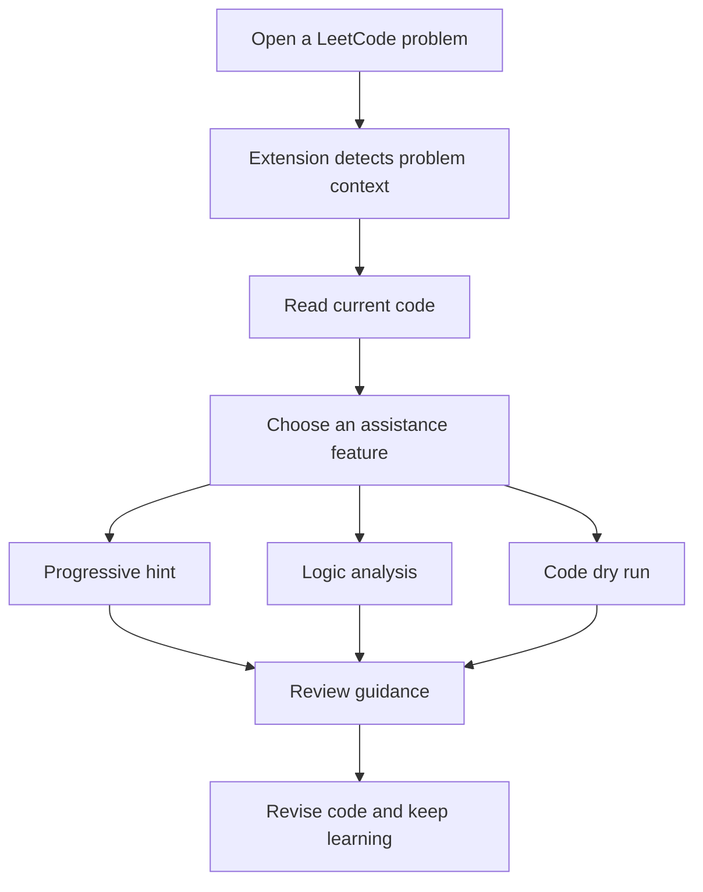
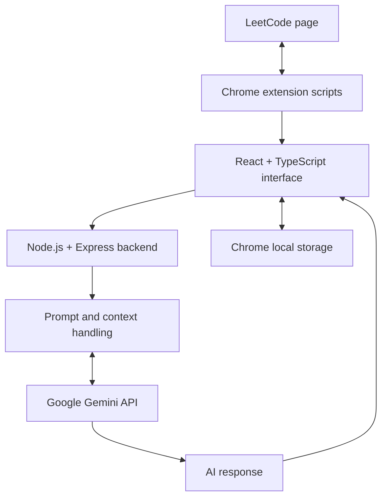

<div align="center">

# PatternMind AI

### Your Personal AI Coding Mentor

**Think Better · Debug Smarter · Solve Independently**


<p>
  An AI-powered Chrome extension that helps learners reason through LeetCode problems,
  inspect their code, and learn from mistakes instead of jumping straight to an answer.
</p>

</div>

<p align="center">
  
  
  
  
  
  
</p>

---

## What is PatternMind AI?

PatternMind AI is a Chrome extension built to support problem-solving practice on LeetCode. It brings AI guidance alongside the coding workflow and is designed to help learners understand *where* their reasoning needs attention and *why* a particular approach may fail.

The focus is guided learning: hints are delivered progressively, code can be reviewed through logic analysis, and useful problem-solving experiences can be saved as learning memory.

## At a glance

- **Progressive hints:** staged guidance from a nudge toward more specific help.
- **Logic analysis:** an explanation of execution and potential logic issues.
- **Code dry run:** a step-by-step view of how code and variables behave.
- **Learning memory:** a place to retain useful problem-solving notes.
- **LeetCode integration:** detects the active problem and works alongside the practice page.

## See it in action

### Extension dashboard and current problem

The extension displays the detected problem, current code, and actions for requesting a hint or analysing logic.

<p align="center">
  
</p>

### Logic analysis

The following captures show the execution trace and explanation sections produced by the logic-analysis experience.

<p align="center">
  
</p>

<p align="center">
  
</p>

### Progressive hints

Hints are designed to reveal guidance in stages, helping the learner keep ownership of the solution.

**Hint Level 1 — Where should I look?**

<p align="center">
  
</p>

**Hint Level 2 — What concept should I think about?**

<p align="center">
  
</p>

**Hint Level 5 — Small code help**

<p align="center">
  
</p>

> These are screenshots from the current development build. AI analysis and hint quality depend on the submitted problem and code; outputs should be reviewed as part of testing.

## How the workflow fits together



## System architecture



## Technology

| Technology | Role |
|---|---|
| React | Extension user interface |
| TypeScript | Frontend application code |
| Vite | Frontend development and build |
| Node.js | Backend runtime |
| Express | Backend API |
| Google Gemini API | AI-assisted hints and analysis |
| Chrome Extension Manifest V3 | Browser integration |
| Chrome Storage API | Local extension data and learning memory |
| JavaScript | Content script, page bridge and extension logic |

## Project layout

```text
PatternMind-Ai/
├── backend/
│   ├── server.js
│   └── package.json
├── extension/
│   ├── manifest.json
│   └── background.js
├── src/
│   ├── assets/
│   ├── App.tsx
│   ├── App.css
│   ├── index.css
│   └── main.tsx
├── docs/
│   └── images/
├── content.js
├── page-bridge.js
├── index.html
├── package.json
└── README.md
```

## Run locally

### Prerequisites

- Node.js and npm
- Google Chrome
- A Google Gemini API key

### 1. Clone the repository

```bash
git clone https://github.com/kritika12-source/PatternMind-Ai.git
cd PatternMind-Ai
```

### 2. Install frontend dependencies

```bash
npm install
```

### 3. Install backend dependencies

```bash
cd backend
npm install
```

### 4. Add the Gemini API key

Create `backend/.env`:

```env
GEMINI_API_KEY=your_gemini_api_key
```

Keep this file private. Do not commit API keys or credentials to GitHub.

### 5. Start the backend

From the `backend` directory:

```bash
node --use-system-ca server.js
```

### 6. Start the frontend

Open a second terminal in the project root:

```bash
npm run dev
```

### 7. Build the extension

Open a third terminal in the project root:

```bash
npm run build
```

The unpacked extension folder must contain `manifest.json`, `background.js`, `content.js`, and `page-bridge.js`, alongside the built frontend assets. If your build does not copy the extension files automatically, copy them into `dist`:

```powershell
Copy-Item ".\extension\manifest.json" ".\dist\manifest.json" -Force
Copy-Item ".\extension\background.js" ".\dist\background.js" -Force
Copy-Item ".\content.js" ".\dist\content.js" -Force
Copy-Item ".\page-bridge.js" ".\dist\page-bridge.js" -Force
```

### 8. Load it in Chrome

1. Open `chrome://extensions/`.
2. Turn on **Developer mode**.
3. Click **Load unpacked**.
4. Select the project's `dist` folder.
5. Open LeetCode and launch PatternMind AI.

## Development roadmap

- [x] React and TypeScript interface
- [x] Node.js and Express backend
- [x] Gemini API integration
- [x] LeetCode problem detection
- [x] Progressive hint interface
- [x] Logic-analysis interface
- [x] Learning-memory interface
- [ ] Verify LeetCode Practice History synchronization end to end
- [ ] Improve AI response formatting in the extension
- [ ] Add learning analytics and progress insights
- [ ] Expand algorithm-pattern recognition
- [ ] Explore support for additional coding platforms

## The idea

A useful coding mentor does not always give you the answer. Sometimes the most valuable help is a small hint, a clear explanation of a mistake, or a question that makes you rethink your approach.

**PatternMind AI is built around that idea: help learners become better problem solvers, one problem at a time.**

---

<div align="center">

**PatternMind AI**

*Think Better · Debug Smarter · Solve Independently*

Developed by **Kritika Grover**

[GitHub Profile](https://github.com/kritika12-source) · [Project Repository](https://github.com/kritika12-source/PatternMind-Ai)

</div>
