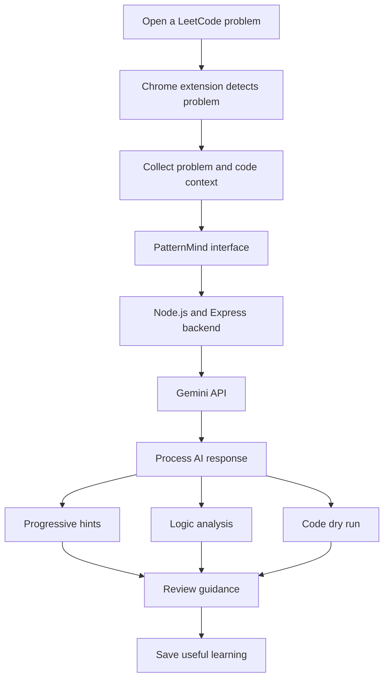
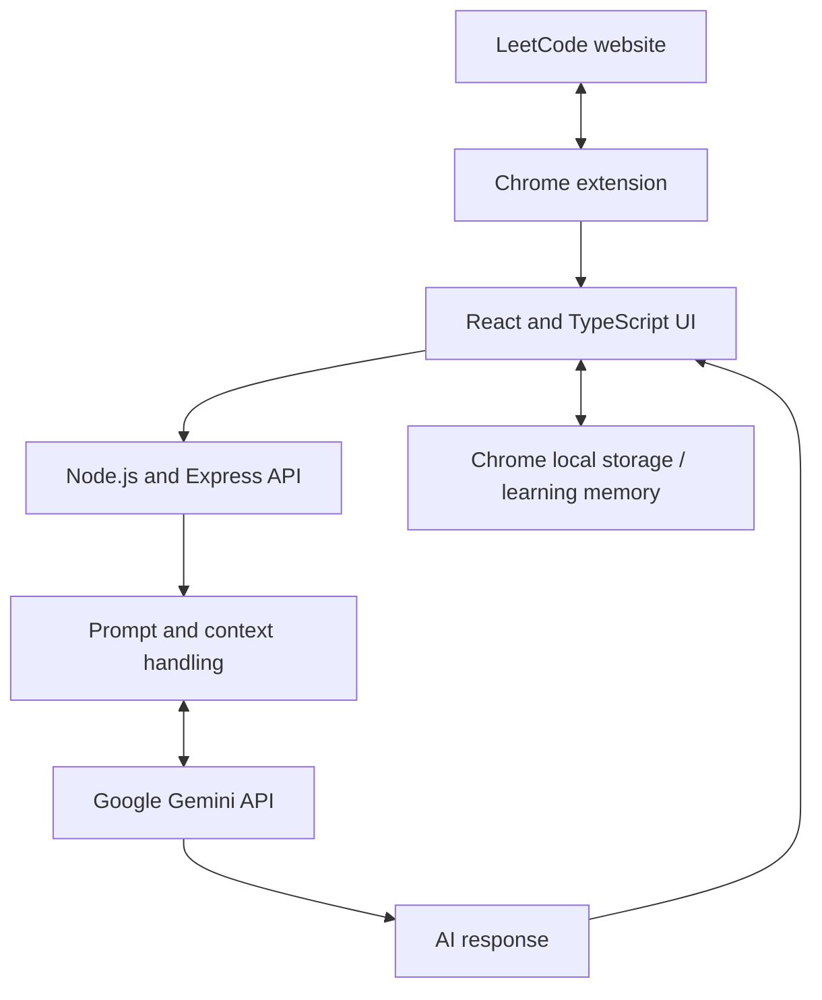

# PatternMind AI
### Your Personal AI Coding Mentor

**Think Better. Debug Smarter. Solve Independently.**

<p align="center">
  
</p>

<p align="center">
  An AI-powered Chrome extension designed to help developers improve their problem-solving skills while practicing on LeetCode.
</p>

<p align="center">
  
  
  
  
  
  
</p>

---

## About

Learning to code is not just about getting the correct output. It is about understanding the logic behind a solution, recognizing mistakes, and learning how to approach similar problems in the future.

PatternMind AI is built around that idea. It works alongside the LeetCode practice environment and provides AI-powered guidance based on the current problem and the code being written. Instead of immediately giving away a complete solution, it aims to help learners think through a problem and improve their own approach.

## What it does

### Progressive AI hints

PatternMind uses a staged hint approach so learners can ask for as much guidance as they need without jumping straight to a complete solution.

| Level | Guidance |
|---|---|
| H1 | Helps identify where to focus |
| H2 | Points towards a relevant concept |
| H3 | Connects the problem with previous learning when a meaningful connection exists |
| H4 | Suggests a next construction step |
| H5 | Offers limited code-level assistance |

### Logic analysis

The logic-analysis feature reviews the student's current code and helps explain possible logical mistakes, incorrect assumptions, and edge cases. It should distinguish an actual logic failure from a potential weakness rather than inventing an error.

### Code dry run

The dry-run experience helps learners follow execution step by step, understand variable changes, and see where a logic issue may occur.

### Learning memory

PatternMind can retain learning information such as saved problems, approaches, patterns, concepts, mistakes, and takeaways. This information can be used to make later guidance more relevant.

### LeetCode integration

The extension is designed to detect the current LeetCode problem and collect relevant coding information for the assistant. LeetCode Practice History synchronization should be described as complete only after it has been verified end-to-end.

## Interface preview

### Main extension view

<p align="center">
  
</p>

The screenshot shows the extension displaying the learning-memory count, detected problem title and difficulty, and the problem description.

### Code panel and actions

<p align="center">
  
</p>

The code panel displays the detected programming language and current code, with actions to analyze logic and request a hint.

## How it works



## System architecture



## Technology

| Technology | Role |
|---|---|
| React | User interface |
| TypeScript | Frontend development |
| Vite | Development server and build tooling |
| Node.js | Backend runtime |
| Express | Backend API |
| Google Gemini API | AI-powered assistance |
| Chrome Extension Manifest V3 | Browser integration |
| Chrome Storage API | Local extension data and learning memory |
| JavaScript | Content and page-bridge scripts |

## Project structure

```text
PatternMind-Ai/
├── backend/
│   ├── server.js
│   └── package.json
├── extension/
│   ├── manifest.json
│   └── background.js
├── src/
│   ├── assets/
│   ├── App.tsx
│   ├── App.css
│   ├── index.css
│   └── main.tsx
├── content.js
├── page-bridge.js
├── index.html
├── package.json
└── README.md
```

## Run locally

### Requirements

- Node.js and npm
- Google Chrome
- A Google Gemini API key

### 1. Clone the repository

```bash
git clone https://github.com/kritika12-source/PatternMind-Ai.git
cd PatternMind-Ai
```

### 2. Install frontend dependencies

```bash
npm install
```

### 3. Install backend dependencies

```bash
cd backend
npm install
```

### 4. Configure the API key

Create `backend/.env`:

```env
GEMINI_API_KEY=your_gemini_api_key
```

Keep this file private. Do not commit API keys or other credentials to GitHub.

### 5. Start the backend

From the `backend` directory, run:

```bash
node server.js
```

### 6. Start the frontend

Open another terminal in the project root and run:

```bash
npm run dev
```

### 7. Build and load the extension

```bash
npm run build
```

Make sure the final unpacked extension directory contains the required `manifest.json`, background script, content script, and page bridge script. Then:

1. Open `chrome://extensions/`.
2. Enable **Developer mode**.
3. Select **Load unpacked**.
4. Choose the prepared extension directory.
5. Open LeetCode and launch PatternMind AI.

## Development roadmap

- [x] React and TypeScript interface
- [x] Node.js and Express backend
- [x] Gemini API integration
- [x] LeetCode problem detection
- [x] Progressive hint framework
- [x] Logic-analysis feature
- [x] Learning-memory framework
- [ ] Verify LeetCode Practice History synchronization end-to-end
- [ ] Add learning analytics and progress insights
- [ ] Improve algorithm-pattern recognition
- [ ] Explore support for additional coding platforms

## Project details

**Project:** PatternMind AI  
**Category:** AI developer tool / Chrome extension  
**AI integration:** Google Gemini API  
**Developer:** Kritika Grover  
**GitHub:** [@kritika12-source](https://github.com/kritika12-source)  
**Repository:** [PatternMind-Ai](https://github.com/kritika12-source/PatternMind-Ai)

---

<p align="center">
  <strong>PatternMind AI</strong><br>
  Think Better. Debug Smarter. Solve Independently.
</p>
